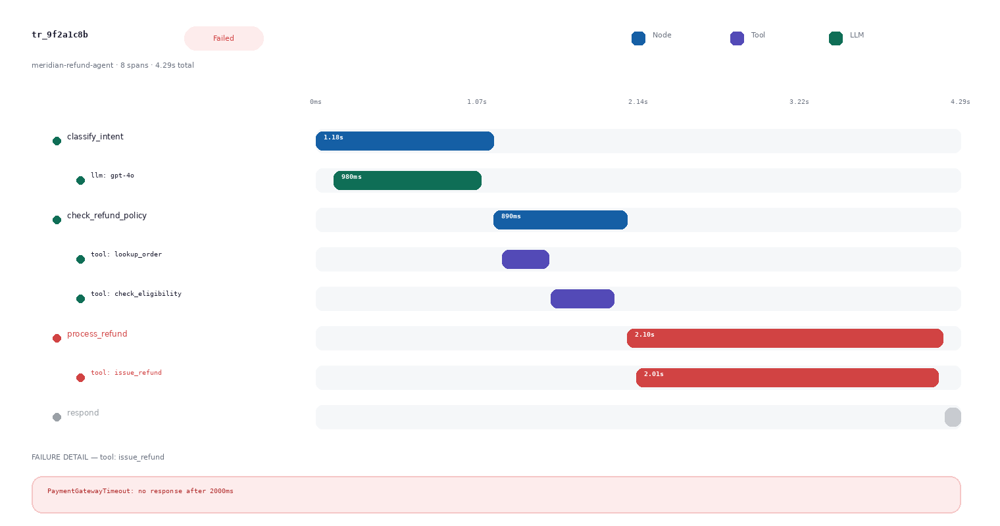
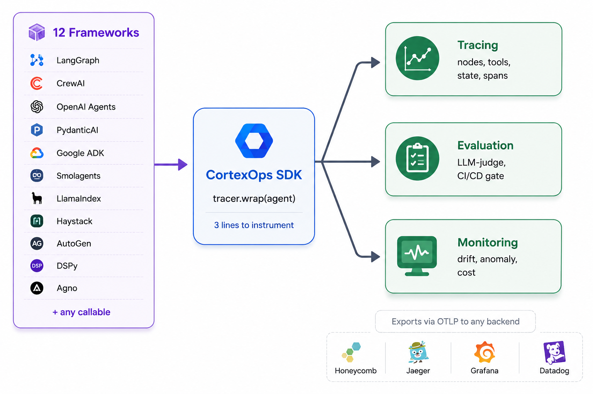
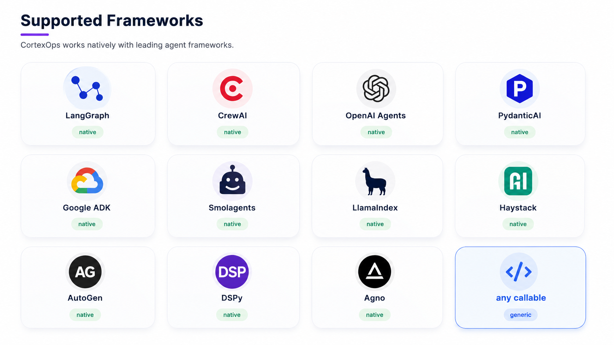
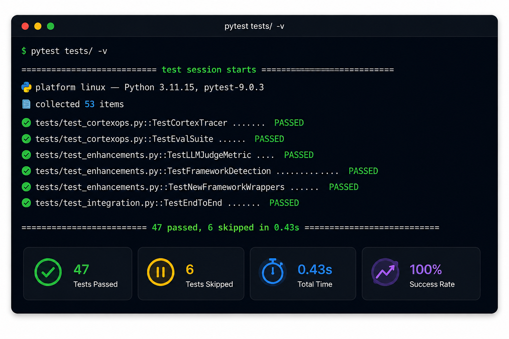

# CortexOps

[](https://github.com/ashishodu2023/cortexops/actions/workflows/security.yml)
[](https://pypi.org/project/cortexops/)
[](https://pypi.org/project/cortexops/)
[](https://pypi.org/project/cortexops/)
[](https://opensource.org/licenses/MIT)
[](https://github.com/ashishodu2023/cortexops/actions)
[](https://getcortexops.com)

**Reliability infrastructure for AI agents.**  
Evaluate · Observe · Operate — for LangGraph, CrewAI, and AutoGen.



## Architecture



## Supported Frameworks



## Tests




[Website](https://getcortexops.com) · [Dashboard](https://app.getcortexops.com) · [Docs](https://docs.getcortexops.com) · [PyPI](https://pypi.org/project/cortexops)
---

## The problem

You deployed an agent. You have no idea if it regressed overnight.

No standard eval format. No failure traces. No CI gate before the next prompt change ships.  
CortexOps fixes that.

---

## Quickstart

```bash
pip install cortexops
```

```python
from cortexops import CortexTracer, EvalSuite

# Wrap your LangGraph app — zero refactor required
tracer = CortexTracer(project="payments-agent")
graph  = tracer.wrap(your_langgraph_app)

# Run evaluations against a golden dataset
results = EvalSuite.run(
    dataset="golden_v1.yaml",
    agent=graph,
)

print(results.summary())
# CortexOps eval — payments-agent
#   Cases           : 9  (7 passed, 2 failed)
#   Task completion : 91.4%
#   Tool accuracy   : 97.0/100
#   Latency p50/p95 : 42ms / 187ms
#   Failed cases:
#     - escalation_router: tool_call_mismatch (score 41)
```

---

## Hosted API (Pro)

The free tier runs evals locally. The Pro tier adds hosted trace storage,
a live dashboard, Slack alerts, and LLM-as-judge scoring.

**Get an API key at [getcortexops.com](https://getcortexops.com)**

Then point the SDK at the hosted API:
```python
from cortexops import CortexTracer, EvalSuite

tracer = CortexTracer(
    project="my-agent",
    api_key="cxo-your-key-here",
    api_url="https://api.getcortexops.com"
)

graph = tracer.wrap(your_langgraph_app)
```

Traces are stored for 90 days. View them in the
[dashboard](https://app.getcortexops.com) or via the
[API docs](https://api.getcortexops.com/docs).

When a production trace fails, promote it to a golden dataset case in one click —
then run the same case in CI before the next deploy.

### Pricing

| Tier | Price | What you get |
|---|---|---|
| Free | $0 | Local evals, CLI, GitHub Actions gate |
| Pro | $49/seat/mo | Hosted traces, Slack alerts, dashboard, LLM judge |
| Enterprise | Custom | VPC, SSO, SLA |

Start a Pro trial: [getcortexops.com/#pricing](https://getcortexops.com/#pricing)


## Golden dataset format

Define test cases in YAML. Run them locally or in CI.

```yaml
# golden_v1.yaml
version: 1
project: payments-agent

cases:
  - id: refund_lookup_01
    input: "What is the status of refund REF-8821?"
    expected_tool_calls: [lookup_refund]
    expected_output_contains: ["approved", "REF-8821"]
    max_latency_ms: 3000

  - id: dispute_escalation_01
    input: "I was charged twice — this is unauthorized"
    expected_tool_calls: [classify_dispute, route_escalation]
    expected_output_contains: ["escalated"]
    max_latency_ms: 5000
```

---

## CI eval gate

Add the [eval-gate GitHub Action](actions/eval-gate) to a workflow:

```yaml
jobs:
  eval:
    runs-on: ubuntu-latest
    permissions:
      contents: read
      pull-requests: write   # for the sticky PR comment
    steps:
      - uses: actions/checkout@v4
      - uses: ashishodu2023/cortexops/actions/eval-gate@main   # pin to a tag or SHA
        with:
          dataset: golden_v1.yaml
          agent: agent:build_agent()
          fail-on: |
            task_completion < 0.90
            tool_accuracy < 0.95
```

It writes a report (metrics, thresholds, failed cases) to the job summary, keeps one comment on the PR up to date, and fails the job if any condition is true. Without the action, the same gate is one CLI call:

```bash
cortexops eval run --dataset golden_v1.yaml --agent "agent:build_agent()" \
  --fail-on "task_completion < 0.90" --output-json report.json --summary-md summary.md
```

GitLab users can include [`ci-templates/gitlab/cortexops-eval.gitlab-ci.yml`](ci-templates/gitlab/cortexops-eval.gitlab-ci.yml); a `cortexops-eval` [pre-commit](.pre-commit-hooks.yaml) hook is also available.

Or gate from pytest (`pip install "cortexops[pytest]"`):

```python
import cortexops

@cortexops.eval_gate("golden_v1.yaml", fail_on="task_completion < 0.90")
def test_payments_agent():
    return build_agent()
```

---

## Repo structure

```
cortexops/
├── sdk/                        # pip install cortexops
│   ├── cortexops/
│   │   ├── tracer.py           # CortexTracer — wraps LangGraph / CrewAI
│   │   ├── eval.py             # EvalSuite — golden dataset runner
│   │   ├── metrics.py          # task_completion, tool_accuracy, latency, hallucination
│   │   ├── models.py           # Pydantic data models
│   │   └── client.py           # HTTP client for hosted API
│   └── tests/
├── backend/                    # FastAPI + Celery + SQLite/Postgres
│   ├── app/
│   │   ├── main.py
│   │   ├── routers/            # /v1/evals, /v1/traces
│   │   ├── models/             # DB records + API schemas
│   │   └── worker/             # Celery async eval tasks
│   └── Dockerfile
├── frontend-new/               # React dashboard (app.getcortexops.com)
├── docs-site/                  # Static docs (docs.getcortexops.com)
├── examples/
│   └── langgraph_payments/     # Full runnable demo
│       ├── agent.py
│       ├── golden_v1.yaml
│       └── run_eval.py
└── docker-compose.yml
```

---

## Run the full stack locally

```bash
git clone https://github.com/ashishodu2023/cortexops
cd cortexops

# Start API + worker + Redis
docker compose up --build

# In another terminal — run the demo eval
cd examples/langgraph_payments
pip install -e ../../sdk/
python run_eval.py

# API docs at http://localhost:8000/docs
# Dashboard at http://localhost:3000
```

---

## Supported frameworks

| Framework | Status |
|---|---|
| LangGraph | Stable |
| CrewAI | Stable |
| AutoGen | Beta |
| LlamaIndex agents | Coming soon |
| Custom callables | Supported via `CortexTracer.wrap()` |

---

## Built-in metrics

| Metric | What it checks |
|---|---|
| `task_completion` | Agent produced a valid, non-error output |
| `tool_accuracy` | Expected tool calls were actually made |
| `latency` | Response within `max_latency_ms` budget |
| `hallucination` | Detects fabrication signals in output |

Add custom metrics by subclassing `cortexops.Metric`.

---
## Roadmap

### v0.5.0 — shipped
- [x] Trace waterfall dashboard view (visual node timeline)
- [x] Production → CI: promote failed traces to golden dataset cases
- [x] FailureKind analytics on dashboard Overview

### v0.5.x — shipped in 0.5.1
- [x] Prompt version tracking in SDK (`tracer.set_prompt(name, version)`)
- [x] Slack webhook alerts on quality regression
- [x] Auto email on Pro key provision (remove manual step)
- [x] Trace sampling configuration (`sample_rate=0.1`, `CORTEXOPS_SAMPLE_RATE`)
- [x] pytest plugin for eval gates (`@cortexops.eval_gate(...)`)

### v0.6.0 — distribution and CI-first
- [ ] GitHub Action for CI eval gates: job summary, sticky PR comment, Marketplace ([#29](https://github.com/ashishodu2023/cortexops/issues/29), covers [#19](https://github.com/ashishodu2023/cortexops/issues/19))
- [ ] GitLab CI template and pre-commit hook ([#31](https://github.com/ashishodu2023/cortexops/issues/31))
- [ ] Reposition as "pytest for AI agents: catch regressions before they ship" ([#30](https://github.com/ashishodu2023/cortexops/issues/30))
- [ ] Cost tracking per eval run (judge API cost) ([#20](https://github.com/ashishodu2023/cortexops/issues/20))
- [ ] Google ADK native tracing ([#39](https://github.com/ashishodu2023/cortexops/issues/39), example [#1](https://github.com/ashishodu2023/cortexops/issues/1))
- [ ] Azure OpenAI tracing example ([#2](https://github.com/ashishodu2023/cortexops/issues/2))
- [ ] Integration pages upstream: LangGraph, CrewAI, PydanticAI, OpenAI Agents SDK, Google ADK ([#36](https://github.com/ashishodu2023/cortexops/issues/36))
- [ ] Open golden datasets for common agent archetypes + Agent Reliability Report ([#37](https://github.com/ashishodu2023/cortexops/issues/37))
- [ ] Activation metric: time to first hosted trace / eval per API key ([#38](https://github.com/ashishodu2023/cortexops/issues/38))
- [ ] Working one-command Docker Compose stack ([#4](https://github.com/ashishodu2023/cortexops/issues/4))
- [ ] Foundations: Alembic migrations + unique constraints ([#47](https://github.com/ashishodu2023/cortexops/issues/47)), transactional outbox for Pro key emails ([#48](https://github.com/ashishodu2023/cortexops/issues/48)), per-task `use_prompt` and PydanticAI async tracing ([#49](https://github.com/ashishodu2023/cortexops/issues/49)), deploy version check ([#46](https://github.com/ashishodu2023/cortexops/issues/46)), CI hygiene ([#50](https://github.com/ashishodu2023/cortexops/issues/50))

### v0.7.0 — ecosystem
- [ ] OpenTelemetry GenAI semantic conventions: OTLP ingest + export ([#32](https://github.com/ashishodu2023/cortexops/issues/32), Jaeger [#5](https://github.com/ashishodu2023/cortexops/issues/5), Tempo [#6](https://github.com/ashishodu2023/cortexops/issues/6))
- [ ] TypeScript SDK `@cortexops/sdk`: tracer + eval gate CLI ([#33](https://github.com/ashishodu2023/cortexops/issues/33))
- [ ] MCP tool-call tracing in the SDK ([#34](https://github.com/ashishodu2023/cortexops/issues/34))
- [ ] CortexOps MCP server for Cursor / Claude Desktop ([#35](https://github.com/ashishodu2023/cortexops/issues/35))
- [ ] Safety checks: prompt-injection and tool-misuse detection ([#41](https://github.com/ashishodu2023/cortexops/issues/41))

### v1.0.0 — enterprise
- [ ] Self-hosting: Docker Compose quickstart + Helm chart ([#40](https://github.com/ashishodu2023/cortexops/issues/40))
- [ ] Multi-tenant dashboard ([#42](https://github.com/ashishodu2023/cortexops/issues/42))
- [ ] SOC 2 compliance mode (audit logs, data residency) ([#43](https://github.com/ashishodu2023/cortexops/issues/43))
- [ ] Enterprise SSO (SAML/OIDC) ([#44](https://github.com/ashishodu2023/cortexops/issues/44))
- [ ] LangGraph Studio integration ([#45](https://github.com/ashishodu2023/cortexops/issues/45))

Want to work on any of these? See [open issues](https://github.com/ashishodu2023/cortexops/issues) or open a [discussion](https://github.com/ashishodu2023/cortexops/discussions).

---

## Contributing

```bash
git clone https://github.com/ashishodu2023/cortexops
cd cortexops/sdk
pip install -e ".[dev]"
pytest tests/ -v
```

See [CONTRIBUTING.md](CONTRIBUTING.md). Issues labeled [`good first issue`](https://github.com/ashishodu2023/cortexops/issues?q=is%3Aissue+is%3Aopen+label%3A%22good+first+issue%22) are a great place to start.

To report a vulnerability, see [SECURITY.md](SECURITY.md).

---

## Citation

```bibtex
@software{cortexops2025,
  author  = {Ashish, et al.},
  title   = {CortexOps: Reliability Infrastructure for AI Agents},
  year    = {2025},
  url     = {https://github.com/ashishodu2023/cortexops},
}
```

---

## License

MIT — see [LICENSE](LICENSE).

---

<p align="center">
  <a href="https://getcortexops.com">getcortexops.com</a> ·
  <a href="https://github.com/ashishodu2023/cortexops/issues">Issues</a> ·
  <a href="https://github.com/ashishodu2023/cortexops/discussions">Discussions</a>
</p>